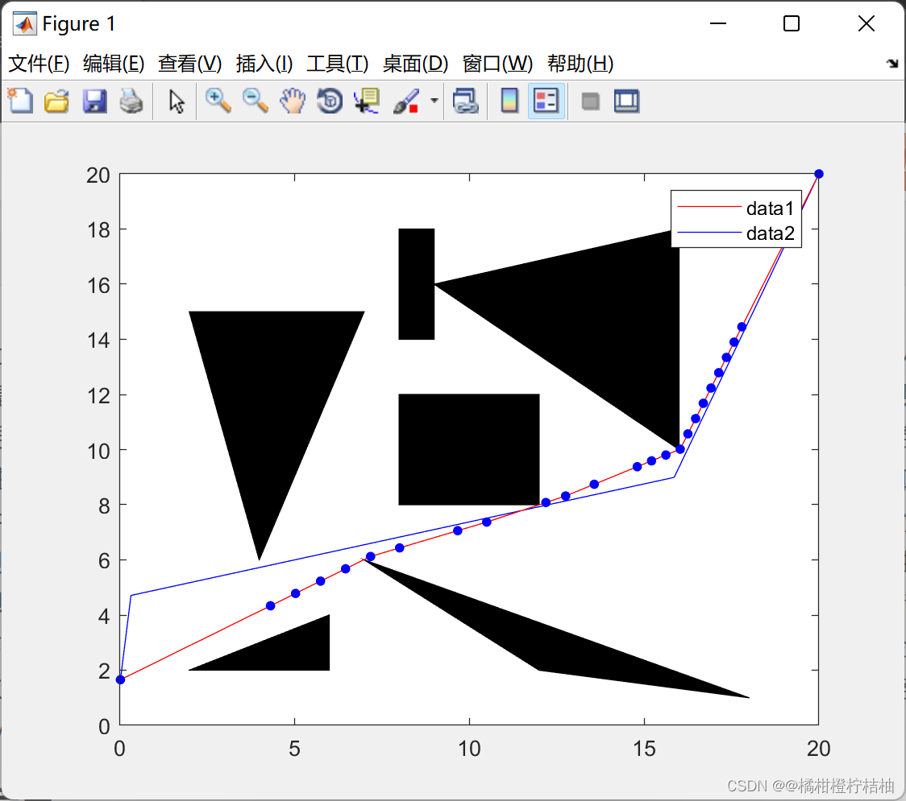
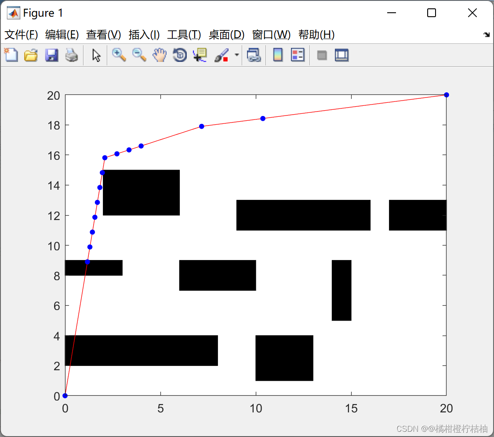
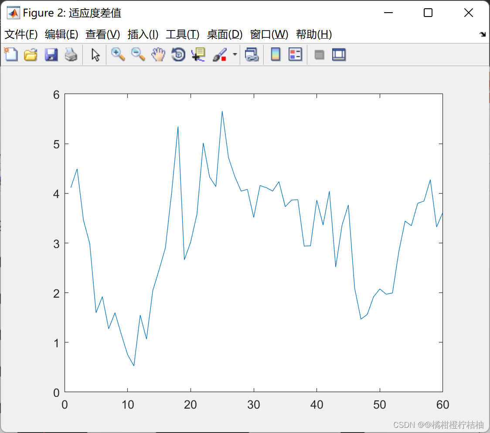
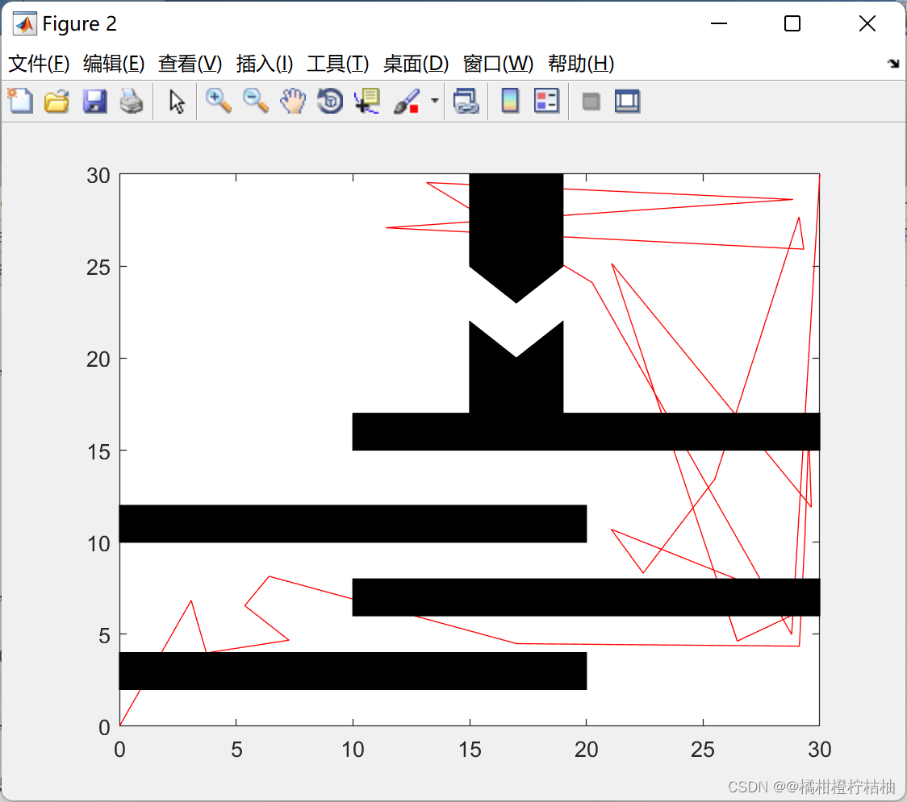

# Path Planning Problem Based on Improved Genetic Algorithm (Matlab Code Implementation)

1 Overview
2 Running Results
3 Matlab Code Implementation
4 Conclusion
5 References
1 Overview
With the development of modern society, an increasing number of people are engaged in the research and development of artificial intelligence. The development of robotics is fundamental to the study of artificial intelligence. Among the most important and basic aspects of robotic research is its corresponding path planning [1]. The essence of path planning is to find the optimal path while avoiding all obstacles and successfully reaching the destination. Currently, the research methods for path planning mainly tend towards intelligent algorithms. These types of algorithms include fuzzy logic control algorithms, ant colony algorithms, and genetic algorithms [8-5], among which the fuzzy logic control algorithm has particularly robust characteristics, can achieve real-time control, and has a weaker dependency on the environment. However, fuzzy rules need to be formulated jointly with human experience and other methods, which affects the performance of the algorithm [8]. Ant colony algorithms use the amount of information left by ants to find the optimal path. This algorithm requires storing a lot of information, and it is prone to confusion or stagnation during the search process, leading to inaccurate results [4]. Genetic algorithms have global search capabilities, require less computational effort, and are robust. Extensive experimental data indicate that traditional genetic algorithms have poor precision and stability during the solution process. This paper solves the path planning problem based on an improved genetic algorithm, implemented using Matlab code.
2 Running Results
3 Matlab Code Implementation
4 Conclusion
The improved genetic algorithm combines the simulated annealing algorithm, which effectively ensures the diversity of individuals in the population and improves the convergence speed of the basic genetic algorithm, enhancing the global search capability of the algorithm. Experimental results show that this algorithm has good convergence capability, can overcome the issue of local optima in traditional genetic algorithms, and can effectively avoid obstacles, arriving at the target point with a shorter path. This lays a foundation for subsequent research on robot motion trajectories and related tasks.
References:
[1] Zhou Jiaquan. Research on Path Planning Problem Based on Improved Genetic Algorithm [J]. Microcomputer Application, 2021, 37(11):1-38

## Images

<!-- PAYMENT_BLOCK -->

## Get this dataset

- Payment link (Stripe): [Buy now](https://buy.stripe.com/3cs8yP7sY87d0vu9AB)
- Payment QR code: 

<!-- /PAYMENT_BLOCK -->
